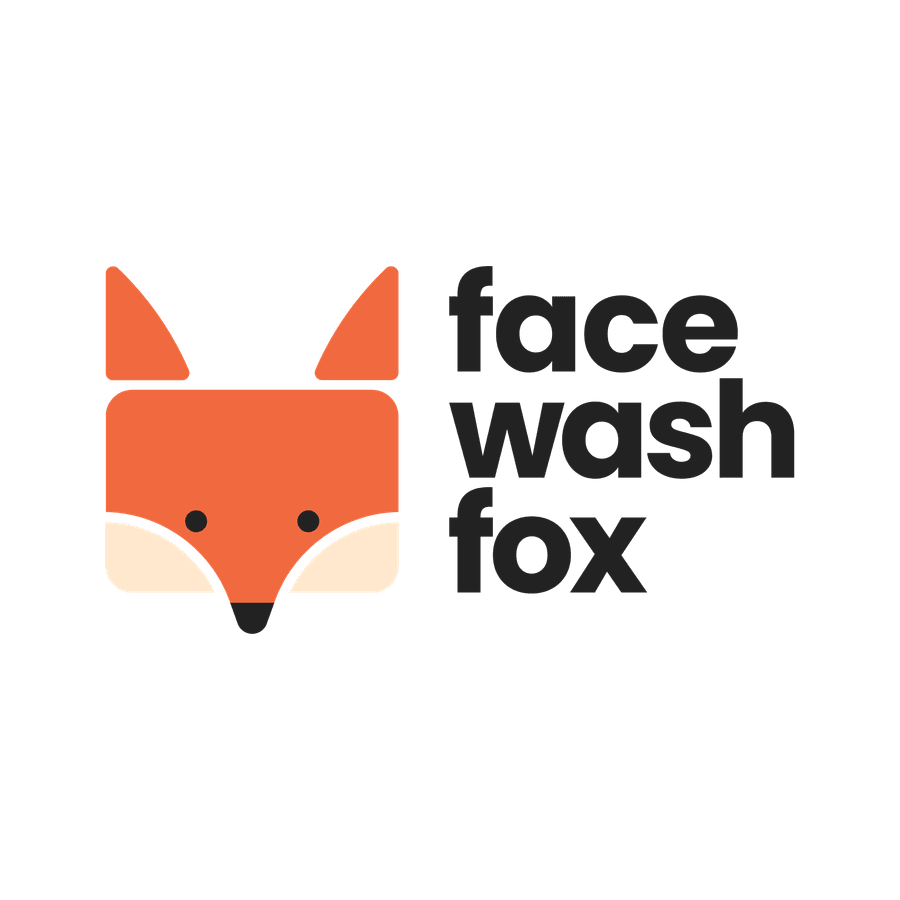

# 🦊 FaceWashFox Store Simulator — Game Quản Lý Spa Chăm Sóc Da Mặt

Một tựa game 3D Simulator quản lý cửa hàng Spa rửa mặt & chăm sóc da chuyên sâu mang thương hiệu **FaceWashFox**, được phát triển dựa trên bản thiết kế Game Design Document (GDD) chi tiết.

---

## 🎮 Cách Chơi Ngay

### Trên Máy Tính (Mac/PC):
* Nhấp đúp chuột vào file **[`start.command`](file:///Users/pc/Desktop/Game/start.command)** hoặc mở trực tiếp **[`index.html`](file:///Users/pc/Desktop/Game/index.html)** trong trình duyệt (Chrome, Safari, Edge...).
* **Phím điều khiển**:
  - `W - A - S - D` hoặc phím Mũi tên: Di chuyển nhân vật.
  - `E` hoặc `Space`: Tương tác (Đón khách, dọn dẹp giường, bắt đầu liệu trình, xếp hàng lên kệ).
  - `Tab`: Mở Điện Thoại Quản Lý Spa (Nhập hàng, tuyển nhân sự, nâng cấp, xem doanh thu).

### Trên Điện Thoại (iOS Safari / Android Chrome):
* Game hỗ trợ **Cần gạt ảo (Virtual Joystick)** ở góc trái màn hình và **Nút bấm cảm ứng `✨`** ở góc phải để thao tác cực mượt mà!

---

## 🏬 Các Khu Vực Trong Cửa Hàng 3D

1. **Quầy Lễ Tân (Reception Desk)**:
   - Tiếp đón khách hàng bước vào từ vỉa hè.
   - Tư vấn gói dịch vụ: *Rửa Mặt Tạo Bọt Cáo (99.000đ)*, *Liệu Trình Fox Glow (199.000đ)*, *VIP Detox Toàn Diện (349.000đ)*.
   - Thu tiền dịch vụ, nhận tiền tip và ghi nhận điểm đánh giá ⭐.
2. **Khu Giường Điều Trị (Treatment Beds)**:
   - 2 giường spa hiện đại có đệm trắng, chăn cam FaceWashFox.
   - Trạng thái giường: Sẵn sàng ➔ Có khách chờ ➔ Đang chăm sóc ➔ Cần vệ sinh & thay khăn.
   - Máy xông hơi và thiết bị sủi bọt siêu âm bên cạnh giường.
3. **Khu Kệ Bán Lẻ Skincare (Retail Shelves)**:
   - Trưng bày 5 dòng sản phẩm chính hãng: Sữa rửa mặt tạo bọt Cáo, Toner cấp ẩm, Serum Vitamin C, Kem dưỡng ẩm, Mặt nạ đất sét.
   - Bổ sung sản phẩm từ kho lên kệ để khách tự chọn mua mang về.
4. **Khu Kho Hàng & Giặt Khăn (Storage & Laundry)**:
   - Lưu trữ hàng hóa từ nhà cung cấp, giỏ khăn bẩn và tủ khăn sạch.
5. **Khu Sofa Chờ (Waiting Lounge)**:
   - Ghế sofa phong cách Bắc Âu ấm cúng và cây xanh Monstera thư giãn.

---

## 🧼 Vòng Lặp Gameplay Rửa Mặt & Spa (Treatment Minigame)

* Đưa khách vào giường sạch ➔ Bấm phím **E** để bắt đầu liệu trình.
* Vuốt chạm/kéo chuột để thoa bọt rửa mặt mịn màng bồng bềnh khắp khuôn mặt, kích hoạt máy sủi bọt siêu âm làm sạch sâu chân lông.
* Âm thanh ASMR bọt nổ tanh tách, tiếng nước ấm và tiếng chuông thu tiền vui tai.
* Dọn dẹp khăn bẩn sau mỗi lượt phục vụ để đảm bảo vệ sinh chuẩn 5 sao!

---

## 📱 Điện Thoại Quản Lý (Management Phone)
* **Tổng Quan**: Theo dõi số dư tiền mặt, điểm danh tiếng sao ⭐, tổng lượng khách phục vụ.
* **Nhà Cung Cấp**: Nhập sỉ thùng sữa rửa mặt, toner, serum và khăn spa sạch.
* **Nhân Sự**: Tuyển Lễ Tân và Kỹ Thuật Viên để tự động hóa đón khách và phục vụ liệu trình.
* **Nâng Cấp**: Nâng cấp máy móc siêu âm, mở rộng nội thất sang trọng.
